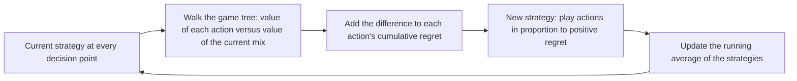

# Saddle Geometry of Heads-Up River Poker
This is an analytical study of the payoff space of heads-up river spots: its shape around the
equilibrium and what a deviation from equilibrium costs. We will also see how equilibria are
computed in practice.

## Contents

1. [The payoff space as a bilinear form](#the-payoff-space-as-a-bilinear-form)
2. [How sensitive is a Nash equilibrium?](#how-sensitive-is-a-nash-equilibrium)
3. [Finding equilibria: CFR and the "corner method"](#finding-equilibria-cfr-and-the-corner-method)
4. [Case study: the clairvoyant game](#case-study-the-clairvoyant-game)
5. [Where the structure breaks](#where-the-structure-breaks)
6. [Repository guide](#repository-guide)
7. [References](#references)

## The payoff space as a bilinear form

**Setting.** Player A maximizes, player B minimizes. A plays a mixed strategy $\sigma$ (a probability
vector over A's pure strategies), B plays $\tau$. A pure strategy is a complete plan: an action for
every hand held. Payoffs count chips received minus chips put in on this street, which is zero-sum up
to a constant (the dead money in the pot). On the river no card is dealt after the cards are known,
and a showdown is a comparison of hand strengths, so the only randomness is the deal.

**Bilinear.** Let $M_{ij}$ be the expected payoff to A when A plays pure strategy $i$ and B plays $j$
(averaged over the deal). With independent randomization,

$$
P(\sigma,\tau)=\sigma^\top M\tau=\sum_{i,j}\sigma_i\tau_j M_{ij},
$$

a weighted average of **corner payoffs**. Three consequences:

- For fixed $\tau$ the payoff is linear in $\sigma$, so a best response can always be taken pure.
  Mixing is never about improving one's own payoff, only about making the opponent indifferent.
- At an equilibrium every pure strategy a player actually uses earns the same against the opponent's
  equilibrium strategy (the **indifference principle**). That is what pins down the mix.
- For square invertible $M$ with nonnegative result, the equilibrium has a closed form
  (Shapley and Snow, 1950; classical): $\tau^\star=M^{-1}\mathbf 1/(\mathbf 1^\top M^{-1}\mathbf 1)$,
  $\sigma^\star=M^{-\top}\mathbf 1/(\mathbf 1^\top M^{-1}\mathbf 1)$, $v=1/(\mathbf 1^\top M^{-1}\mathbf 1)$.

**The saddle and its curvature.** Strategies live on simplices, so only directions that keep the
probabilities summing to one are allowed (the tangent space). Expanding the bilinear form around a
saddle point with full support gives an identity with no truncation,

$$
P(\sigma^\star+\delta\sigma,\ \tau^\star+\delta\tau)=v+\delta\sigma^\top M\ \delta\tau .
$$

In coordinates the payoff is $P=a+b^\top x+c^\top y+x^\top D\ y$, with $D=Z_A^\top MZ_B$ the matrix
$M$ restricted to the tangent directions, and at the saddle $P=v+dx^\top D\ dy$. So the payoff
surface is a saddle whose whole shape is the single matrix $D$: no higher-order terms exist, because
$P$ has degree at most one in each player's variable. The singular values of $D$ form a
**sensitivity spectrum**, and its kernel gives the non-uniqueness of the equilibrium. Strategies
that are unused at equilibrium add first-order penalties, their **regrets**.

Derivations: [docs/matrix_games.md](docs/matrix_games.md), Section 2.

## How sensitive is a Nash equilibrium?

**Measure.** The **exploitability** $\varepsilon(\sigma,\tau)$ is how many chips a perfect opponent
can win from a pair of strategies (the standard way to measure strategy quality in poker, see
Johanson et al., 2011). It splits into one term per player,

$$
\varepsilon(\sigma,\tau)=\ell_A(\sigma)+\ell_B(\tau),
$$

where $\ell_A$ is what A gives away against a best-responding B, and likewise $\ell_B$. A pair with
$\varepsilon\le\delta$ is called $\delta$-Nash here. (This is the sum of both losses. Many authors
bound each loss separately, which differs by a factor of 2.)

**Three questions about a deviation $\delta\sigma$ from equilibrium:**

1. *The opponent keeps playing Nash.* Deviating within the support costs nothing: the payoff stays
   exactly $v$.
2. *The opponent best-responds.* The loss is a maximum of finitely many linear functions of the
   deviation, one per pure strategy of the opponent. It is therefore piecewise linear, **first order
   in the size of the mistake, with a kink at the equilibrium**, and not quadratic. In practice it is
   computed by enumerating the opponent's pure strategies (a vertex enumeration or a linear program),
   always in the full game.
3. *Both players err.* The payoff changes through the cross term $\delta\sigma^\top M\ \delta\tau$,
   at most $\varepsilon_A\varepsilon_B\ \sigma_{\max}(D)$ in a chosen norm. This is the range of the
   payoff surface, second order, and not the exploitability. Its constant depends on the norm, which
   must be stated.

**Open questions (hypotheses, not claims):**

1. *How steep is the minimum?* The worst-direction slope is governed by $D$, but the clairvoyant game
   already shows that it is not governed by the singular values of $D$ alone (see the case study).
   The equilibrium's position inside the strategy simplex matters too. A Hoffman-type error bound
   should make this precise.
2. *Can exploitability be tiny while strategies are far from equilibrium?* For hands ordered by
   showdown strength, the smallest singular values of $D$ may go to $0$ as the number of hands grows,
   which would give many almost-free deviation directions.
3. *When is the equilibrium unique?* The answer is the kernel of $D$, and how it changes with several
   bet sizes.

Derivations: [docs/matrix_games.md](docs/matrix_games.md), Sections 2.5 and 2.6.

## Finding equilibria: CFR and the corner method

### CFR (counterfactual regret minimization)

The idea: play the game against yourself repeatedly. At every decision point keep, for each action,
the **regret** of not having played it, meaning how much better it would have done than the current
mix. Next round, play actions in proportion to their positive regret (*regret matching*). Averaged
over rounds, the strategies converge to an equilibrium of a two-player zero-sum game, and it is the
**average** strategy that converges, not the last one. The exploitability of the average is known to
shrink like $1/\sqrt T$ after $T$ rounds (Zinkevich et al., 2007), and the variant CFR+ (Tammelin, 2014)
is usually faster in practice.

CFR never forms the payoff matrix. It stores one strategy per decision point, and one round costs
time linear in the size of the game tree.

### The corner method

Because $P$ is a weighted average of corner payoffs, the matrix $M$ of payoffs at all pairs of pure
strategies determines everything. The method:

1. Compute $M_{ij}$ for every pair of pure strategies (every corner).
2. Guess the supports $S_A,S_B$ of the equilibrium, of equal size, such that the submatrix $M_S$ is
   invertible.
3. Solve the indifference conditions $M_S\tau_S=v\mathbf 1$, $\mathbf 1^\top\tau_S=1$, which gives the
   closed form above applied to $M_S$, and likewise for $\sigma$.
4. Check that all entries are nonnegative and that no strategy outside the support does better, **in
   the full game**. Exploitability zero certifies the answer.

This is exact and non-iterative, but it has three weaknesses:

- **Size.** A pure strategy assigns an action to every hand, so with $N$ hands and $k$ actions each
  there are $k^N$ of them. The matrix $M$ cannot even be written down for realistic ranges.
- **Support search.** Finding the right supports is combinatorial. A linear program avoids that, but
  still needs the full matrix.
- **All or nothing.** There is no useful intermediate answer, while any CFR iterate has a measurable
  exploitability.

This is why CFR is the better tool on large spots: it works on the game tree, so memory and time per
round grow linearly with the tree. The exact polynomial alternative is the linear program on the
**sequence form** (von Stengel, 1996; Koller, Megiddo and von Stengel, 1996), which is the corner method with the size
problem removed. In this project the corner method is used for what it is good at: building $M$ for
small and discretized spots to study the geometry, and verifying answers.

## Case study: the clairvoyant game

The smallest interesting poker game, and a place where every idea above can be checked by hand. Pot
$1$, bet $s$. A holds a bluff-catcher (beats air, loses to the nuts). B holds the nuts or air with
probability $\tfrac12$ each and acts first: bet or check. If B bets, A calls or folds. There are no
raises.

**Corners.** A has two pure strategies (fold, call). B has four: an action with the nuts and an
action with air, written bet ($\mathsf b$) or check ($\mathsf k$). Averaging over B's hand gives

$$
M=\begin{array}{c|cccc}
 & \mathsf{bk} & \mathsf{bb} & \mathsf{kk} & \mathsf{kb} \cr \hline
\mathsf f & \tfrac12 & 0 & \tfrac12 & 0 \cr
\mathsf c & \tfrac{1-s}{2} & \tfrac12 & \tfrac12 & \tfrac{1+s}{2}
\end{array}
$$

**Equilibrium.** Checking the nuts is dominated (the best hand always bets), and the remaining
$2\times2$ game is solved by indifference, by the matrix formula, and by calculus with a boundary.
All three agree: A calls with probability $x^\star=\tfrac1{1+s}$, B bluffs with air with probability
$y^\star=\tfrac{s}{1+s}$, and the value is $v=\tfrac{1}{2(1+s)}$. Against the full $2\times4$ matrix the
exploitability is exactly $0$.

| bet $s$ | A calls | B bluffs with air | value $v$ |
|---|---|---|---|
| $\tfrac12$ | $\tfrac23$ | $\tfrac13$ | $\tfrac13$ |
| $1$ | $\tfrac12$ | $\tfrac12$ | $\tfrac14$ |
| $2$ | $\tfrac13$ | $\tfrac23$ | $\tfrac16$ |

**The bilinear form.** In coordinates $x=P(\text{A calls})$, $y=P(\text{B bluffs})$,

$$
P=\tfrac12-\tfrac s2\ x-\tfrac12\ y+\tfrac{1+s}{2}\ xy,\qquad
P=v+\tfrac{1+s}{2}\ (x-x^\star)(y-y^\star),
$$

so $D=\tfrac{1+s}{2}$ and the second identity holds exactly on the whole square of strategies.

**Sensitivity.**

- Against a Nash opponent, any calling frequency earns exactly $v$.
- Against a best-responding opponent the loss is linear in the mistake: slope $\tfrac s2$ for calling
  too often (B stops bluffing) and $\tfrac12$ for calling too rarely (B bluffs everything). With
  pot $1$ and bet $1$, calling $60\%$ instead of $50\%$ lowers A's guaranteed payoff from $0.25$ to
  $0.20$: a $20\%$ loss of value for a $10$-point mistake.
- The exploitability is $\varepsilon=\ell_A+\ell_B$ with the same two slopes for each player. The set
  of $\delta$-Nash pairs is a skewed diamond around the equilibrium, with vertices at distance
  $2\delta/s$ and $2\delta$ along each axis.
- If both err, the payoff moves by at most $\tfrac{1+s}{2}\ \varepsilon_A\varepsilon_B$, second order.
  For $s=1$ and two mistakes of $0.1$ that is $0.01$, against $0.05$ for A's loss from the
  over-call alone.
- Checking the nuts is a boundary direction: every unit of probability B puts on it costs
  $\tfrac{s}{2(1+s)}$ at first order, and this penalty does not involve $D$.
- The over-calling slope $\tfrac s2$ tends to $0$ for small bets, although $D\to\tfrac12$. So the slope
  is not set by the singular values of $D$ alone, which already refines the first open question.

The identities were checked numerically for four bet sizes on random deviations. A CFR run on this
game as an independent cross-check is not done yet.

Derivations: [docs/clairvoyant_game.md](docs/clairvoyant_game.md), Section 6. Code:
[notebooks/01_clairvoyant.ipynb](notebooks/01_clairvoyant.ipynb).

## Where the structure breaks

- **Only the river.** With cards still to come, a pair of pure strategies no longer has a payoff that
  can be looked up, and the strategy space is far larger. A bilinear form still exists for any such
  game through the sequence form (von Stengel, 1996), but $M$ and $D$ lose their simple
  structure.
- **Independent randomization.** Bilinearity needs the players' mixes to be independent. Correlated
  play breaks it.
- **Size.** $k^N$ pure strategies. The sequence form removes this and changes the strategy set from a
  simplex to a polytope $\lbrace r\mid Er=e,\ r\ge0\rbrace$. Whether the arguments above carry over
  unchanged is still to be checked.
- **Boundary equilibria.** The clean form $v+\delta\sigma^\top M\ \delta\tau$ needs full support.
  Otherwise first-order regret terms appear, and finding the support is the hard step.
- **Dominance is tree-specific.** "The nuts always bet" relies on A having no action after a check.
- **Raises and several bet sizes.** Uniqueness of the equilibrium may fail. Not yet examined.
- **Card removal (blockers).** My holding changes which hands you can hold, which breaks the pure
  ranking structure of the showdown. Ignored so far.
- **Threshold strategies.** If a strategy is parametrized by thresholds on hand strength rather than
  by mixing probabilities, the payoff is no longer polynomial and the biaffine form does not apply.
- **The norm.** Singular values and the size of $\varepsilon$-balls depend on the chosen norm.

## Repository guide

| Path | Contents |
|---|---|
| `docs/matrix_games.md` | Matrix games, indifference, exploitability, the exact local form |
| `docs/clairvoyant_game.md` | The clairvoyant game and its sensitivity analysis |
| `docs/glossary.md` | Poker terms for readers without a poker background |
| `notebooks/` | Code: payoff matrices, verification, figures (one notebook per case study) |
| `figures/` | Images used in the documents |

## References

Most equations here have no single origin. The bilinear form and the exact local form are elementary
consequences of bilinearity, derived in this repository without a specific source. The works below
are where the surrounding ideas come from. † marks entries whose bibliographic details are given
from memory and have not been checked against the source.

**Game theory**

- J. von Neumann, "Zur Theorie der Gesellschaftsspiele", *Mathematische Annalen* 100 (1928),
  295-320 †. The minimax theorem.
- L. S. Shapley and R. N. Snow, "Basic solutions of discrete games", in H. W. Kuhn and A. W. Tucker
  (eds.), *Contributions to the Theory of Games, Vol. I*, Annals of Mathematics Studies 24,
  Princeton University Press, 1950 †. The structure of optimal strategies and the closed form on
  square submatrices.

**Poker**

- B. Chen and J. Ankenman, *The Mathematics of Poker*, ConJelCo, 2006 †. Toy models such as the
  clairvoyant game, and threshold strategies.
- M. Johanson, K. Waugh, M. Bowling and M. Zinkevich,
  ["Accelerating Best Response Calculation in Large Extensive Games"](https://ijcai.org/Abstract/11/054),
  IJCAI 2011. Best responses and exploitability as the measure of strategy quality.
- M. Bowling, N. Burch, M. Johanson and O. Tammelin, "Heads-up limit hold'em poker is solved",
  *Science* 347 (2015), 145-149 †.

**Computing equilibria**

- M. Zinkevich, M. Johanson, M. Bowling and C. Piccione,
  ["Regret Minimization in Games with Incomplete Information"](https://proceedings.neurips.cc/paper/2007/hash/08d98638c6fcd194a4b1e6992063e944-Abstract.html),
  *Advances in Neural Information Processing Systems 20* (NIPS 2007). Counterfactual regret
  minimization (CFR).
- T. W. Neller and M. Lanctot,
  ["An Introduction to Counterfactual Regret Minimization"](https://cupola.gettysburg.edu/csfac/19),
  EAAI-13, 2013. A gentle introduction to CFR.
- O. Tammelin, ["Solving Large Imperfect Information Games Using CFR+"](https://arxiv.org/abs/1407.5042),
  arXiv:1407.5042, 2014.
- B. von Stengel, "Efficient computation of behavior strategies", *Games and Economic Behavior*
  14(2) (1996), 220-246. The sequence form.
- D. Koller, N. Megiddo and B. von Stengel, "Efficient computation of equilibria for extensive
  two-person games", *Games and Economic Behavior* 14(2) (1996), 247-259.

**Error bounds**

- A. J. Hoffman, ["On approximate solutions of systems of linear inequalities"](https://nvlpubs.nist.gov/nistpubs/jres/049/4/V49.N04.A05.pdf),
  *Journal of Research of the National Bureau of Standards* 49(4) (1952), 263-265. The kind of bound
  intended for relating distance to equilibrium with exploitability (planned; not used yet).
